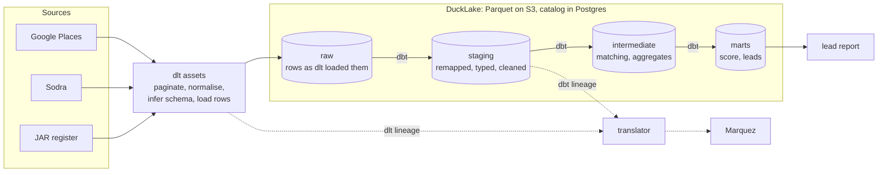
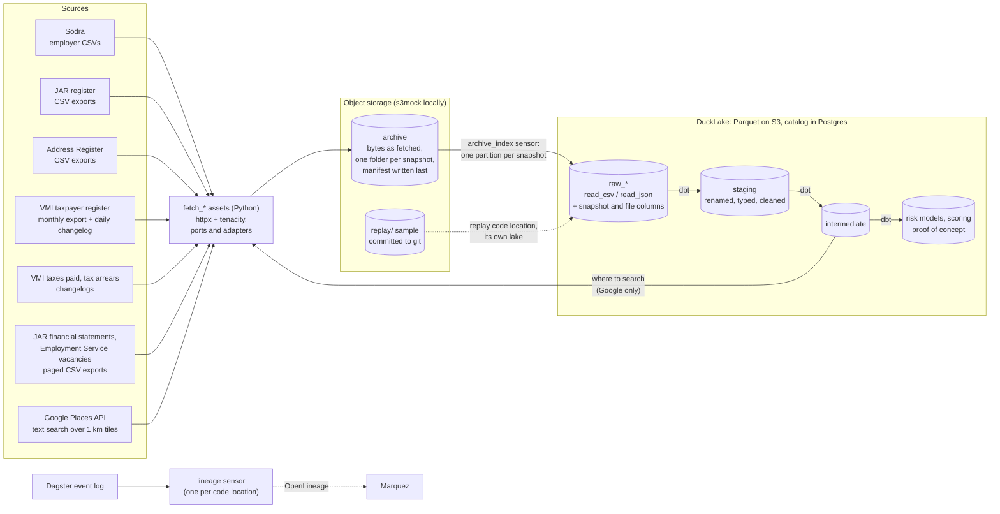
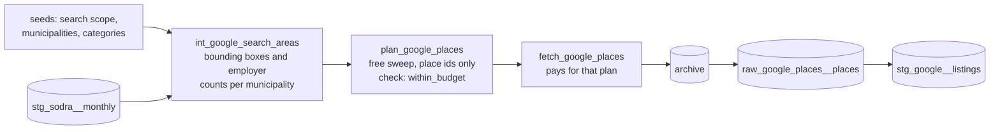

# OWL: Off-books Work Locator (Working Title)

Why the platform under the lead list looks the way it does: what I wanted from it, the plan I
started with, and what it became.

## Why lineage first

My day job is in market abuse monitoring, and the thing that hurts most there is traceability.
We have hundreds of assets with complicated relationships between them, and working out how a
given column in one of our reports is derived is incredibly difficult. That also makes changing
domain logic risky. We cope by keeping several copies of production: change something in one,
then wait and see what moves. So when a stakeholder asks for a logic change, building it might
take days, but releasing it can take a month or more of watching a pre-prod environment for
surprises. That is bad enough on its own. It gets much worse when a data source changes its
schema and the logic has to follow, because then there is no month to wait.

So I took this assignment as a chance to build something that leans on
[OpenLineage](https://openlineage.io/) as far as is practical. Lineage is only useful if it is
continuous from source to report, which sets one rule for the whole design: **keep as little
data handling in Python as possible, and where Python can't be avoided, use tools that report
lineage.**

## The stack

**Dagster** orchestrates, because its DAGs are built from assets (the data) rather than from
tasks (the functions that make it). Airflow 3 has assets now too, but they sit on top of a
task-based model. Truth be told, Dagster was also something I'd always wanted to try. In a real
production setup, especially on AWS, I'd probably just use Airflow on MWAA, or Step Functions if
the orchestration needs were simple enough.

**dbt** runs all the SQL: tests, models for shared logic, lineage, and, honestly, because I
thought it would be cool. I wanted dbt 2.0, but the DuckDB adapter and many of the extensions
haven't been updated for it yet. It's also no longer open source, which is sad. I tried SQLMesh
as well, but in my experiments it was quite buggy, its extensions and integrations were thin, and
it overlaps with what Dagster already does.

**DuckDB and DuckLake** store everything. DuckDB 2.0 is in alpha and may ship this month, and
I'd been playing with the alpha in my spare time. I got a bit obsessed with it: it's very fast in
synthetic benchmarks, its extension ecosystem is good, it parses relational and non-relational
data in the same SQL, and it's light enough to make local development painless. DuckLake is
meant to fix DuckDB's biggest weakness, several clients working on the same database at once
([the pitch](https://ducklake.select/), and
[the technical side](https://duckdb.org/docs/current/connect/concurrency#multiple-processes)).
With 2.0 close and [AWS buying the company behind it](https://duckdb.org/library/aws-ducklabs-about-amazon/),
DuckDB felt interesting and topical. I wouldn't use it in a real solution just yet, though.

What the repo actually runs is the stable DuckDB 1.5.6, not the alpha, with DuckLake attached for
real: Parquet files on S3 (s3mock locally), with the catalog in Postgres. It earns its place. Each
source's dbt step runs in its own process, and several run at once, all writing to the same lake.
With a plain DuckDB file that failed straight away ("Could not set lock on file"), so DuckLake is
what lets the sources build side by side. It's also what lets Python (the Google planner, the
lake MCP server) read the lake while dbt writes to it. It isn't magic, though. Two transactions
that delete from and insert into the same table still conflict, so every table keeps one writer
at a time (a Dagster pool per source). And the time travel I planned to use for month-on-month
comparisons isn't used yet.

## The original plan

The first plan was a simple ELT setup: dlt loads each source into a raw DuckLake table, and
dbt takes it from there. Staging remaps columns, sets types and cleans up. Intermediate holds
any shared logic. mMrts holds the final report (or data used by external systems).

## What changed

Two pieces of the plan didn't survive contact with the code: dlt, and dagster-openlineage.

### dlt is gone

dlt didn't last long, for two reasons.

**Its lineage didn't join up with dbt's.** dlt's OpenLineage integration names datasets its own
way, so connecting it to dbt's lineage needed a fairly complex translator in between. It was
complicated enough that it broke constantly.

**DuckDB could do dlt's job.** Given the sources I'd picked (CSV exports and JSON REST
responses), DuckDB can parse the fetched files directly. So instead of dlt appending rows to a
raw table, the fetch now saves each response byte for byte into an archive, and the raw table is
just DuckDB reading those files (`read_csv`, `read_json`) plus a few metadata columns: which
snapshot, which file, when it was fetched. Staging is built from there with DuckDB's own parsing.

It turned out faster, and it makes raw genuinely raw. Pagination aside, what an analyst or data
scientist sees in raw is exactly what the source returned. There's no column remapping or
filtering hidden somewhere in the code. And because the archive keeps every response unfiltered,
an analyst can query those files with DuckDB and see exactly what the source sends, including
columns we don't use yet. They don't need a developer to set up a Postman collection so they can
call the API themselves, a kind of friction that happens all the time where I work now.

### dagster-openlineage is gone too

With dlt out, the plan was for Dagster to be the only thing emitting lineage, through
[dagster-openlineage](https://docs.dagster.io/integrations/libraries/openlineage).
That one failed as well.

**The storage-wrapper mode breaks Dagster.** It wraps Dagster's Postgres event storage to catch
every event, but it only passes through the storage's abstract methods. Everything else falls
back to the base class's defaults. The one that matters: the storage then says it doesn't
support concurrency limits, so every pool (one writer per lake table, the thing that stops two
runs from corrupting the same table) would silently stop limiting. No error, just pools that no
longer do anything. A couple of other methods would raise or do nothing.

**The sensor mode avoids that, but has its own problems.** It tails the whole Dagster instance.
I run two code locations (live and replay), so with a sensor in each, every event would be sent
twice. And by default it reads only 30 events every five minutes.

**Neither mode draws a usable graph.** Both send each materialization with no inputs, so Marquez
would show every asset alone, connected to nothing, which defeats the entire point. Both also give
every asset in a Dagster run that run's id, while OpenLineage expects one run id per job run. A
materialization outside any run (the archive index's) has no run id at all, and Marquez rejects
it. The official `openlineage-dagster` package stops at Dagster 1.6.9, so it wasn't an option
either.

So lineage is sent by a small sensor of my own, one per code location
(`owl_dagster_orchestration/lineage/`). It reads each of its own assets' materializations, sends
each asset as an OpenLineage job that reads its parents, and gives each materialization a stable
run id, so sending it again doesn't create duplicates. Along the way it adds what Marquez is here
for: column lineage, column descriptions from the dbt YAML, each dbt test's result as data
quality, and the SQL dbt compiled for that build.

OpenLineage's event model is simple enough to write directly and if it does fail, it does not
affect domain logic.

### How it turned out

This is what the pipeline looks like now:

Python now touches the data in exactly one place: the fetch, which writes files and nothing
else. Everything from raw onward is dbt, so column lineage runs unbroken from raw to the last
model. It starts at raw rather than at the source, because the SQL parser that works out column
lineage can't see inside archived files. The risk models at the end are a proof of concept (see
below).

The setup does have open problems, and I don't have good answers to them. What happens with a
real-time source, where there's no file to archive? How would a gRPC or other RPC source fit in
without breaking the "archive the bytes, parse in SQL" pattern?

### Four more sources

Sodra only tells you so much. It hides the average wage *and* the contributions of every employer
with three or fewer insured people, which is 26% of Vilnius cafés, 48% of car repair shops and 72%
of hair and beauty salons. For exactly the businesses this is about, the "declared" side was mostly
a headcount. So four more open datasets from get.data.gov.lt went in, each as an archived source
like the others:

| Source | What it adds | How it's fetched |
|---|---|---|
| JAR financial statements | income statements and balance sheets since 2015 (6.5 M and 9.6 M line items), plus the lists of companies that didn't file or filed late | quarterly, as the register reloads them, in pages of 500,000 rows |
| VMI taxes paid | everything a company paid VMI (VAT, corporate tax, withheld income tax, excise), net of refunds, per company and month from 2025-04 | monthly, through the dataset's changelog |
| VMI tax arrears | who owes VMI, how much is overdue or deferred, and for how long, from 2024-11 | monthly, through the changelog |
| Employment Service vacancies | 3.2 M job ads since 1990, with the company, the offered pay and the workplace address | monthly, in pages of 400,000 rows |

All four join to a JAR company code for 97–100% of rows. The vacancies' workplace address is a
bonus for matching Google listings: in Vilnius it differs from the company's registered address
for 54% of ads, and the registered address is exactly what makes matching hard.

The portal taught me a few things the hard way:

- **It drops any response after about 25 minutes,** and its backend sends at 0.6–1.6 MB/s, so a
  multi-GB export never finishes. Worse, its cache then keeps the cut-off copy and serves it as if
  it were whole: the first income-statements snapshot held 3.2 M of its 6.5 M rows, and nothing
  flagged it. Big exports are now fetched in pages (Spinta's `count()`, `limit()` and `page()`),
  each page checked against the count and the export's version.
- **Big downloads stream into the archive, gzipped,** written beside the file and moved into place
  only once whole. Before that, a download that failed halfway replaced a good file.
- **A snapshot is what its manifest lists.** Raw models read only the files the manifest names, so
  a file left behind by an earlier attempt is never read.
- **The data has its own quirks.** VMI reloads whole datasets and sometimes publishes obvious errors
  (a one-month arrears of 935.8 M EUR for one sole proprietorship). The register published every
  financial statement twice after a reload in March 2026. And the Employment Service has loaded
  only a fraction of new vacancies since July 2026, so recent months there are incomplete.

One fix wasn't about sources at all. DuckDB refuses to change its spill folder once it has
spilled, and dbt-duckdb set it again on every query, so after any big build the tests in the same
dbt run failed. The folder is now set once, when dbt opens the database.

## Where assets pay off

The asset model really pays off when the result of some SQL is used to call a remote service,
and that service's response becomes another asset. At work we have a three-layer setup like
that. Data from one source is modified and joined, then used to call an API. The response is a
new dataset, but the data that made the call stays in use too. Stack three layers like that,
with the data stored in files, in Postgres or not stored at all (in-memory Polars dataframes
only), and finding out which column is used where, or whether it's used anywhere, becomes hell.
Orchestrating it through hand-written DAGs, or worse Step Functions, makes the whole system
rigid: everything is coupled, so a minor change can have massive downstream effects. As a
result, changes are kept as small and as rare as possible, and known issues stay forever because
fixing them is too much effort.

*The Pragmatic Programmer* calls this broken windows. One unrepaired window signals that nobody
cares, and the rest soon follow. When every fix is expensive, every known issue becomes a broken
window that nobody is willing to repair. The point of an asset graph is to make fixing cheap
enough that you actually do it: each dataset, including the ones a remote call produced, is a
node with its parents on record, so the blast radius of a change is visible before you make it.

This repo already has a small version of that loop. Where Google gets searched is computed in
SQL from Sodra and seed data, and that result drives a paid API call:

Change the seed and the search areas, the plan and its cost estimate rebuild by themselves.
Nothing gets paid for until the next fetch, and every step is a node you can trace.

## Code architecture: ports and adapters

For the Python I tried [hexagonal architecture](https://en.wikipedia.org/wiki/Hexagonal_architecture_(software)),
also called ports and adapters. I worked on a .NET solution built this way, and the decoupling,
flexibility and testability were very nice. In this repo the ingest code defines what it needs as
ports (`owl_ingest/ports/`: a downloader, the Places API, the raw archive, the search areas), and
the adapters (`owl_ingest/adapters/`: httpx, fsspec/S3, DuckLake) plug into them, so the tests run
against in-memory fakes. It works, but I'm not sure it maps that well to Python. The abstractions
don't feel very pythonic, and there may be a better-fitting pattern I don't know about.

## A proof-of-concept fraud detection model in SQL

I'm not an accountant and don't know much about detecting financial crime. So what exists is a
framework for suspicion that someone like me can at least read, plus one worked example. It was
written by Claude; I set the shape and the naming, not the domain logic.

Here each suspicion is a **risk model**: one hypothesis, stated in a sentence, with its legitimate explanations
written next to it.

- **Each risk model is a dbt group** (`models/risk/<id>/`): private steps, and one public output
  with an enforced contract and a version, so a v2 can run beside v1. Every output has the same
  columns: company, month, the model's own measure, its percentile against peers (same 4-digit
  activity class, in the municipality when it has 20 or more companies, else nationally),
  whether it fired, the evidence as JSON, and a one-sentence explanation.
- **A registry seed** (`risk_models.csv`) holds each model's hypothesis, legitimate
  explanations, sources, family and weight. The scoring picks a model up from its row, and a test
  fails if the registry and the models disagree.
- **Scoring** (`fct_company_risk`) applies eligibility gates first (active in JAR, at least six
  months in Sodra, not being wound down), then a weighted mean of the percentiles. A company is
  tier A only if models from **two different families** fire, and a company with fewer than two
  models with data is "insufficient evidence", never a lead.
- **The one model, `rm_wage_floor`,** looks for envelope wages: a declared average wage stuck at
  the minimum wage (0.95–1.05×) for six months running, while peers pay more. In August 2026 it
  fired for 376 companies nationally, and in Vilnius for 6 cafés and restaurants, 7 car repair
  shops and 2 hair and beauty salons. My first measure, "the share of months at the minimum",
  turned out to be zero for 81% of companies, so it ranked nothing. That alone says the
  thresholds need someone who knows the domain.

It runs nationally, which is where DuckDB earns its place: the company-month profile (4.5 M rows,
260,000 companies), the model and both scoring marts build in about a minute on the dev machine,
43 seconds of it dbt's own work.

Known issues:

- **With one model, everything is "insufficient evidence"** by design. The rule needs two.
- **It has only been built on dev targets.** The lakes build it once it's merged and Dagster
  reloads.
- **JAR only publishes a company's current status,** so a company wound down in August counts as
  eligible in the months before.
- **The archive's Sodra history starts in 2025-01,** so the earliest months fail the six-month gate.
- **Thresholds were calibrated on one month of data** and haven't been checked against anything
  real.
- **The model list has to reach dbt before it parses** (dbt can't read a seed at parse time), so
  the launchers pass it in an environment variable, and plain `dbt` without it fails on purpose.

The financial statements did show one thing worth knowing about my own first idea, "years of
losses without going bankrupt means someone is paying the bills off the books". In these trades,
29–50% of Vilnius companies make a loss in any given year and a third to a half have negative
equity, so a plain loss streak flags hundreds. Counting only loss years in the bottom quarter of
the same category's margins, it narrows to 92 companies with three such years and 24 with five.

## CI/CD

There is nothing to deploy, so the CD here is releases.

**Trunk-based, with main as the release branch.** 
[python-semantic-release](https://python-semantic-release.readthedocs.io) reads the commit messages
since the last tag: `fix:` bumps the patch, `feat:` (any change in logic) the minor, and a breaking
change the major, but only after 1.0. It writes that one version into every `pyproject.toml`,
`dbt_project.yml` and `uv.lock`, updates the changelog, tags, and makes a GitHub release.
 The history before v0.1.0 doesn't follow the format, so the changelog starts there.

**CI runs in the real dev container.** GitHub builds it the way VS Code does (the devcontainer
CLI), with every compose service, and runs `.devcontainer/ci.sh`, the same script I run locally.
With the services there anyway, the integration tests use the real Postgres, s3mock and Marquez
instead of fakes, each test session in databases, a bucket and Marquez namespaces of its own, so
they never touch the dev data.

**act only runs the light workflows.** In the dev container it shares the host's Docker, so the
dev-container job would start a second copy of the whole stack next to the one I work in. For that
job, `ci.sh` in the dev container is the local equivalent.

**Every tool version lives in one place that Dependabot updates** (the Dockerfile, `uv.lock`, the
dev container features, the actions' commits), or isn't pinned at all.
Dagster and DuckDB are left to update by hand, as they're pinned
together with things Dependabot can't update.

**NAlpine images.** I wold like to use Alpine distro images everytwhere, but DuckDB has no musl wheel,
so every build would compile it from source. Only Postgres runs on Alpine, and the other services have no Alpine variants.

**The dev container has a memory cap** (8 GB, no swap), so a runaway process, usually DuckDB, dbt or
an agent, is killed inside it instead of the whole machine swapping until the desktop freezes. On a
machine with more RAM, raise it first (the README's machine size section).

CodeQL checks the Python and the workflows, and coverage shows as a badge and as a comment on each
pull request.

## What I wanted to add but didn't have time for

**Recce on pull requests.** CI and releases are in now ([CI/CD](#cicd)), but not the
build-validation step I wanted most: running [Recce](https://github.com/DataRecce/recce) to produce
schema and data diffs on each pull request, so reviewers can see how a change to the domain logic
plays out, even across complex data structures. SonarQube Cloud is on the list too, for coverage
and code quality over time.

**Matching Google Places listings to companies.** The Google side works: the search areas are
planned, the listings fetched, archived and cleaned into `stg_google__listings` (name, address,
coordinates, rating, reviews, opening hours). But I didn't have time to find a way to map a listing
to a company code consistently. Listings carry brand names, not legal names, and a company's
registered address is often not where it trades: "INVENTA", a bar company registered at
Kalvarijų g. 125 in Vilnius, has no listing under its name, and that address has 12 listings,
three of them a café, a bar and a restaurant. So for now the Google data can't say anything about
a company.

**The rest of the risk models.** The sources for them are in, but the models aren't:
- overdue tax arrears that keep growing;
- missing or late financial statements;
- low taxes paid per insured worker;
- a busy company not registered for VAT;
- persistent losses against peers;
- job ads offering more than the declared wage;
- the Google side, which waits on the matching above.

I also wouldn't know how to check whether their results are valid. So this project is more a
showcase of a somewhat impractical, but hopefully technically interesting data platform (lake, lakehouse, whatever the right word is) than a finished tax-fraud detector.
